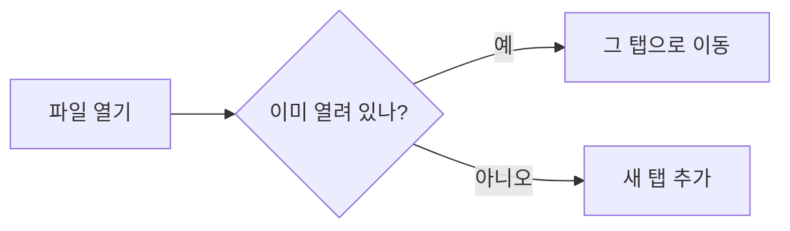

# 새로 들어온 것들

여러 문서를 한 창에서 탭으로 보고, 프롬프트 같은 코드 블록은 버튼 하나로 복사할 수 있습니다.

## 복사 버튼

코드 블록 위에 마우스를 올리면 오른쪽 위에 **복사** 버튼이 나타납니다.

```text
너는 꼼꼼한 편집자야. 아래 글을 읽고
1) 맞춤법을 고치고
2) 문장을 더 간결하게 다듬어 줘.
```

## 콜아웃

> [!NOTE]
> 참고할 만한 내용을 담는 상자입니다.

> [!TIP]
> 단축키 `Ctrl+Tab` 으로 다음 탭으로 넘어갈 수 있습니다.

> [!WARNING] 저장 전 확인
> 저장하지 않은 탭을 닫으면 한 번 물어봅니다.

## 수식

질량과 에너지의 관계는 $E = mc^2$ 입니다. 가격 표기 $5와 $10 은 수식으로 바뀌지 않습니다.

$$
\int_0^1 x^2 \, dx = \frac{1}{3}
$$

## 다이어그램



## 찾기

`Ctrl+F` 를 누르고 단어를 입력하면 문서 안에서 모두 표시되고, `Enter` 로 다음 결과로 넘어갑니다.
